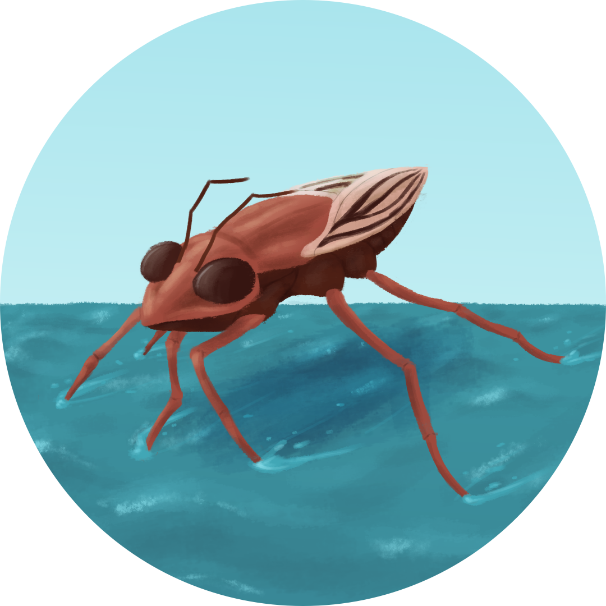

# Nartnik

> Logo made by my great friend [pepeTheSmugMan](https://github.com/pepeTheSmugMan/)!

A private bot that bridges one Discord server and one Fluxer server. Messages in paired channels are relayed
through webhooks so they appear under the author's name and avatar on the other platform. On Fluxer it can
also import a channel's Discord history.

## Requirements

- Node.js 22.13 or newer
- A Discord bot and a Fluxer bot, each invited to its server

## Setup

1. Install dependencies:

   ```bash
   npm install
   ```

2. Copy the example files and fill them in:

   ```bash
   cp .env.example .env
   ```

   ```bash
   cp config.example.yaml config.yaml
   ```

   `.env` holds only tokens. `config.yaml` holds server IDs and settings, plus the initial channel/user/emoji
   pairs (imported into the database once, see [Mappings](#mappings)). Every ID in `config.yaml` must be a
   quoted string.

3. **Discord bot** (Developer Portal):
   - Bot → Privileged Gateway Intents: enable **Message Content** and **Server Members**.
   - Invite with the permissions View Channels, Send Messages, Read Message History, Manage Webhooks.
     If `DISCORD_CLIENT_ID` is set, the bot logs a ready-made invite link at startup.

4. **Fluxer bot**: give it a role with View Channel, Read Message History, Send Messages, Add Reactions
   and Manage Webhooks in the bridged channels.

5. Start it:

   ```bash
   npm start
   ```

   On first start the bot creates one webhook per bridged channel on each side and stores it in SQLite
   (`data/nartnik.db`). If a webhook is deleted later, a new one is created automatically.

## Mappings

Bridged channels, linked users, mapped custom emoji and mapped roles are stored in the database and changed
with commands on Fluxer (below). Changes apply immediately, no restart needed.

On the very first start the bot copies the `channels`, `users`, `emoji` and `roles` lists from `config.yaml`
into the database and records that in the `meta` table (`config_links_imported`). From then on those lists
are ignored. To import them again on the next start (adding only pairs that aren't in the database yet),
delete the flag:

```bash
sqlite3 data/nartnik.db "DELETE FROM meta WHERE key = 'config_links_imported'"
```

## Using it

- Anything posted in a paired channel appears on the other side, including edits, deletes, attachments,
  replies, linked-user mentions, mapped roles and mapped custom emoji. Mapped role mentions show as real
  role mentions but never ping anyone.
- **Mapping commands (Fluxer only)**, for members with a role listed in `fluxer.privileged_role_ids`.
  The examples use the `!` prefix. The space after the prefix is optional (`! map ...` works too).
  - `!map channel <Discord channel ID>`, run in the Fluxer channel to bridge. It also sets up the webhooks.
  - `!map user @someone <Discord user ID>` links a Fluxer member with a Discord account.
  - `!map emoji :emoji: <Discord emoji ID>`: write the Fluxer custom emoji itself.
  - `!map role <Fluxer role ID> <Discord role ID>`: IDs, not mentions, so nobody gets pinged.
  - `!unmap #channel`, `!unmap @someone`, `!unmap :emoji:` or `!unmap <role ID>` removes a mapping.
    `!unmap` with nothing after it unbridges the current channel. A Discord-side ID works too.
- **History import (Fluxer only)**, run inside a bridged Fluxer channel by a member with a role listed in
  `fluxer.privileged_role_ids`:
  - `!import 500` fetches the newest 500 Discord messages of the paired channel and posts a summary.
    The same member confirms by reacting with the ✅ emoji to it. Messages are then posted in their original order, about
    60 per minute. Messages that are already bridged are skipped.
  - `!import cancel` stops a running import.
  - If the bot restarts during an import, it carries on where it stopped.

## Tests

```bash
npm test
```

## Deployment

- **systemd:** see [deploy/nartnik.service](deploy/nartnik.service).
- **Docker:** `docker compose up -d --build` (reads `.env`, mounts `config.yaml` and `./data`).
- **pm2:** `pm2 start src/index.js --name nartnik` from the project folder.

Back up `data/nartnik.db`: Fluxer only shows a webhook's token once, and the message ID map is what makes
edits, deletes and replies work for older messages.

## Known limits

- Both platforms label webhook messages as app/bot messages; this cannot be removed.
- Reactions, threads, stickers, pins and voice are not bridged.
- Discord webhooks cannot reply, so replies arriving on Discord show a quote line with a jump link.
- Attachments larger than the target's upload limit are sent as links. Discord attachment links expire after
  about a day.
- Messages written while the bot is offline are not relayed later (use `!import` to backfill Discord → Fluxer).
